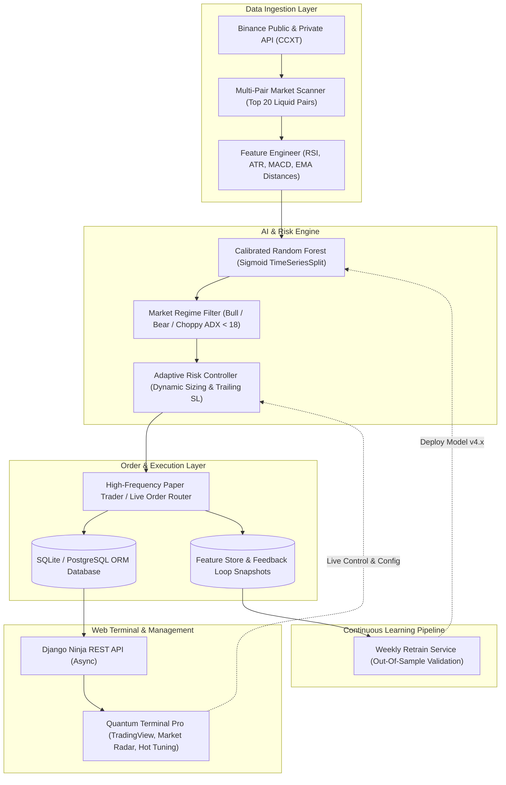

# ⚡ Algo-Trade-Core (Quantum Scalper Pro v4.0)
> **Institutional-Grade Autonomous AI Quantitative Scalping Engine & Real-Time Trading Terminal**

[](https://www.python.org/)
[](https://django-ninja.dev/)
[](https://scikit-learn.org/)
[-44CC11?style=for-the-badge&logo=pytest&logoColor=white)](https://docs.pytest.org/)
[](https://cloud.oracle.com/)
[](https://opensource.org/licenses/MIT)

---

## 🌟 Executive Summary

**Algo-Trade-Core** is a high-throughput, low-latency quantitative algorithmic trading platform tailored for cryptocurrency spot and derivatives markets (Binance via CCXT). 

Engineered with **Hexagonal / Clean Architecture**, the platform combines **Supervised Machine Learning (Calibrated Random Forest ensembles)**, **dynamic regime classification (Bull / Bear / Choppy via ADX & MACD)**, **continuous MLOps retraining pipelines**, and an institutional **Reactive Web Terminal** featuring real-time TradingView charting, PnL analytics, and hot-reloadable risk controls.

---

## 🏛️ System Architecture



---

## 🚀 Key Architectural Modules

### 1. 🧠 Autonomous AI Brain & Regime Detection
* **Probability Calibration:** Employs `CalibratedClassifierCV` (Sigmoid + `TimeSeriesSplit`) to guarantee that model output represents true empirical probability rather than uncalibrated confidence scores.
* **Microstructure Feature Engineering:** Extracts 36+ quantitative features on 5-minute candles:
  * Rolling volatility (ATR %, Bollinger Bandwidth).
  * Momentum & Trend strength (ADX, MACD Histogram lags, EMA 9/21/50/200 cross distances).
  * Candle anatomy (Upper/Lower wick ratios, body-to-range ratios).
* **Regime Filter:** Completely blocks entry during choppy consolidations (`ADX < 18.0`), eliminating over-trading in ranging markets.

### 2. 🎛️ Quantum Terminal Pro (Real-Time Web Dashboard)
* **Interactive UI:** Futuristic dark-mode quantitative cockpit featuring real-time equity curves, win rate tracking, profit factor benchmarks, and market radar heatmaps.
* **TradingView Integration:** Embedded TradingView Lightweight Charts with dynamic symbol switching (`BTC`, `ETH`, `SOL`, `XRP`, etc.) and candlestick overlay.
* **Hot Parameter Tuning:** Live modal allowing dynamic adjustments of:
  * *Confidence Threshold* (0.20 – 0.50)
  * *Risk-to-Reward Ratio* (1.2 – 3.0)
  * *Trade Fraction (% Balance per position)*
  * *Max Concurrent Positions* (1 – 5)
  * *Min ADX Trend Threshold*
* **Emergency Circuit Breaker:** One-click **Panic Sell All** for instantaneous liquidation of all open inventory.

### 3. 🔄 Continuous MLOps & Feedback Loop
* **Trade Snapshot Store:** Upon entry, the exact quantitative feature vector is snapshotted into an SQLite/PostgreSQL Feature Store.
* **Labeling Engine:** Upon trade closure, outcomes are automatically labeled as `1` (profitable) or `0` (loss/stop-out).
* **Automated Retraining:** The `WeeklyRetrainService` ingests new trade telemetry, applies strict Out-of-Sample (80/20) validation, and seamlessly promotes newly trained model weights without downtime.

### 4. 🛡️ Institutional Risk Management
* **Dynamic Sizing:** Position allocation scaled based on account equity and user-defined risk fraction.
* **Smart Exit Logic:** Dynamic Trailing Stop-Loss tracks profit peaks and locks in gains while providing room for winning runs.
* **Fee Awareness:** Hardened safety filters ensure that expected profit strictly outpaces exchange taker fees (0.10%).

---

## 🧪 Test Suite & Quality Assurance

The codebase adheres to rigorous test-driven standards with **100% test pass rate**:

```bash
======================= 43 passed, 0 failures in 12.52s =======================
```

* **Unit Tests (`tests/unit/`):**
  * Mathematical accuracy of Adaptive Risk & Kelly sizing.
  * Feature extraction pipeline consistency.
  * Model inference & edge-case fallback logic.
  * Paper trading accounting (PnL, balance reserves, drawdown calculations).
* **Integration Tests (`tests/integration/`):**
  * REST API endpoints (Ninja routers, status, control triggers).
  * Database transaction isolation & concurrency guards.

---

## ☁️ Production Deployment (24/7 Cloud Architecture)

The system is deployed on an **Oracle Cloud Infrastructure (OCI) Always-Free Linux VM** (Frankfurt, Germany):

* **OS:** Ubuntu 22.04 LTS (x86_64, 4GB Swap configured)
* **Runtime:** Python 3.12 Virtual Environment (`venv`)
* **Process Orchestration:** Dual `systemd` background daemons:
  * `algo-bot.service`: Continuous market scanning & execution engine.
  * `algo-web.service`: High-performance Django Ninja web server.
* **Fault Tolerance:** Automated restart on failure (`Restart=always`, `RestartSec=10`), log rotation via `journald`, and firewall persistence with `iptables`.

---

## 🛠️ Quickstart & Local Installation

### Prerequisites
* Python 3.12+
* Git
* Virtualenv

### 1. Clone & Set Up Environment
```bash
git clone -b feature/quantum-terminal-pro https://github.com/DudarDev/algo-trade-core.git
cd algo-trade-core

# Create virtual environment
python3 -m venv venv
source venv/bin/activate  # On Windows: .\venv\Scripts\activate

# Install dependencies
pip install --upgrade pip
pip install -r requirements.txt
```

### 2. Configure Environment Variables
Create a `.env` file in the root directory:
```env
DEBUG=False
DJANGO_LOG_LEVEL=INFO
SECRET_KEY=your-secure-secret-key-here
BINANCE_API_KEY=your_binance_api_key
BINANCE_SECRET_KEY=your_binance_secret_key

# Trading Risk Parameters
TIMEFRAME=5m
CONFIDENCE_THRESHOLD=0.22
RISK_REWARD_RATIO=1.5
MAX_CONCURRENT_POSITIONS=3
TRADE_FRACTION=0.04
```

### 3. Run Database Migrations
```bash
python src/manage.py migrate
```

### 4. Execute Full Test Suite
```bash
pytest tests
```

### 5. Launch the Platform
```bash
# Terminal 1: Launch Web Dashboard
python src/manage.py runserver 0.0.0.0:8000

# Terminal 2: Launch Autonomous AI Bot Engine
python main.py
```

Access the Quantum Terminal at `http://localhost:8000/bot_monitor/dashboard/`.

---

## 🧰 Technology Stack

| Layer | Technologies |
| :--- | :--- |
| **Core Engine** | Python 3.12, AsyncIO, CCXT, NumPy, Pandas, Pandas-TA |
| **Machine Learning** | Scikit-Learn (Random Forest, CalibratedClassifierCV), Joblib |
| **Web & API** | Django 5.x, Django Ninja (Pydantic V2), WhiteNoise, Gunicorn |
| **Frontend UI** | HTML5, Modern CSS Grid, JavaScript (Fetch API), TradingView Lightweight Charts |
| **Testing & CI/CD** | Pytest, Pytest-AsyncIO, GitHub Actions |
| **Infrastructure** | Linux (Ubuntu 22.04 LTS), Systemd, Oracle Cloud Infrastructure (OCI), Iptables |

---

## 👨‍💻 Author

**Yaroslav Dudar**  
*Quantitative Software Engineer / Python Backend Architect*  
* GitHub: [@DudarDev](https://github.com/DudarDev)

---

## ⚖️ Disclaimer

*This software is developed for research and institutional quantitative engineering demonstration purposes. Cryptocurrency trading involves substantial financial risk. Always validate algorithmic strategies extensively in simulation (Paper Trading) before committing capital.*
